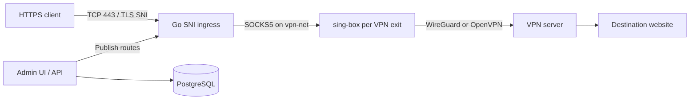

# SNI Gateway

[](LICENSE)
[繁體中文](README.zh-TW.md)

Route HTTPS connections to different VPN exits by domain name. SNI Gateway uses a Go ingress and **sing-box for both provider and custom VPN exits**, with a web UI for exits, routing rules, subscriptions, and publication.

The gateway reads the TLS Server Name Indication (SNI), selects the published route, and forwards the original connection through the chosen VPN. TLS remains between the client and destination website; the gateway does not need the website's certificate or private key.

## Architecture



Docker Compose runs the backend and PostgreSQL. The backend serves the built React UI, manages a `singbox-<exit-name>` container for each exit, and switches to a prepared routing table when rules are published.

| Port | Purpose |
| --- | --- |
| Host TCP 80 | Redirect matched domains to HTTPS; unmatched domains return 404 |
| Host TCP 443 | TLS passthrough using published SNI rules; unmatched names are closed |
| `127.0.0.1:8080` | Admin UI and API |
| Container TCP 1080 | Per-exit SOCKS listener on the private `vpn-net` network; not published on the host |

Destination DNS lookups go through the selected VPN. Custom OpenVPN profiles that identify the VPN server by hostname use local DNS to establish the tunnel first.

## Requirements

- Docker and Docker Compose v2 with `up --wait` support, and an account that can access the Docker daemon.
- Bash and OpenSSL for installation; Git and `flock` for updates.
- Available host TCP ports 80, 443, and loopback port 8080.
- VPN credentials or a complete custom WireGuard/OpenVPN configuration.

Docker builds both the backend and frontend. Go and Node.js are only needed on the host for local development.

## Install

Run from the repository checkout:

```bash
./sni-gateway.sh install
```

The installer creates a private `.env` with random admin credentials when one does not exist, builds the application, prepares the sing-box image specified by the backend, and waits for Compose health checks. An existing `.env` is retained and its credentials are validated.

Open `http://127.0.0.1:8080` and sign in with `ADMIN_USERNAME` and `ADMIN_PASSWORD` from `.env`. For a remote server, forward the admin port over SSH:

```bash
ssh -L 8080:127.0.0.1:8080 user@gateway-host
```

Then open the same local URL. Keep `.env` and database backups private; they contain credentials and VPN configuration.

## Configure routing

1. **Create an exit.** Select a built-in provider, country or city, and WireGuard or OpenVPN. Enter the credentials requested by the form. To use your own VPN server, choose **Custom configuration** and import a WireGuard `.conf` or a portable OpenVPN `.ovpn` profile with its required certificates and keys.
2. **Check the exit.** Startup probes the public IP through the VPN. **Running** indicates that the probe succeeded; **Unhealthy** indicates failure. **Logs** shows runtime output, and **Check status** probes the current connection again.
3. **Add rules.** Map exact domains or domain suffixes to exits. The rules page supports search and pagination.
4. **Publish.** Validate and publish the saved rules from **Publish**. New connections immediately use the published table. Rollback restores the previous table. Subscription syncs can also publish updates.
5. **Send client traffic to the gateway.** Configure client DNS or a hosts entry for the routed domains, then access them over HTTPS.

Provider credentials depend on the provider and protocol: OpenVPN may require service credentials and client certificates; WireGuard requires a private key and, where applicable, a tunnel address and preshared key. The UI shows the required fields.

For automatic provider selection, a selected city determines the endpoint filter; otherwise the country is used. Each connection measures up to four candidate endpoints from container startup through a successful public-IP probe. It selects the fastest successful candidate and tries another successful candidate if the final connection fails. Each trial’s public-IP probe allows up to 40 seconds, with a five-minute limit for the overall connection process. Only the sampled candidates are compared. **Restart** repeats selection; **Check status** only probes the current endpoint. The displayed public IP is the measured VPN exit address, which can differ from the catalog endpoint IP.

WireGuard environment YAML and OpenVPN YAML exports are application import/export formats, not standalone Compose files. See the [API reference](docs/API.md) for request examples.

## Configuration

Edit `.env` before installing or applying an update:

| Variable | Default / behavior |
| --- | --- |
| `ADMIN_USERNAME` | `admin` on first install |
| `ADMIN_PASSWORD` | Randomly generated on first install |
| `JWT_SECRET` | Randomly generated on first install |
| `TLS_IDLE_TIMEOUT` | `5m`; closes TLS connections after no traffic in either direction |
| `EXIT_RESTART_CRON` | `@every 12h`; use `disabled` to turn off scheduled exit restarts |
| `PROVIDER_CATALOG_UPDATE_INTERVAL` | `24h` |

Published route snapshots and the provider catalog cache use the `published_routes` volume. PostgreSQL uses `postgres_data`. The backend accesses the Docker socket to create, inspect, and stop exit containers.

## Operations

```bash
# Check for updates without changing the deployment
./sni-gateway.sh update --check

# Back up PostgreSQL, update the tracked branch, rebuild, and wait for health
./sni-gateway.sh update --apply

# Inspect the application and a VPN exit (replace EXIT_NAME)
docker compose ps
docker compose logs --tail=100 backend
docker logs --tail=100 singbox-EXIT_NAME

# Stop managed exits and the Compose stack
./scripts/stop.sh
```

The updater preserves database and route volumes. Existing VPN containers keep their current runtime image until restarted; use **Restart** in the UI after an image update. See [application updates](docs/UPDATES.md) for unattended updates, backups, and recovery.

Compose health checks verify application readiness. They do not verify that a VPN can reach a destination. To test the full path, create and publish an exact rule for `api.ipify.org`, then run this command with your gateway's IP:

```bash
curl --noproxy '*' --max-time 30 \
  --resolve api.ipify.org:443:GATEWAY_IP https://api.ipify.org/
```

The response should be the selected VPN's public IP. `--resolve` sends the connection to the gateway while preserving the destination hostname and TLS certificate verification.

If Docker reports permission denied for its socket, check `docker info` and your current session's group membership. After an administrator grants Docker access, start a new login session so the group change takes effect. If the application is healthy but HTTPS fails, inspect the exit logs and use **Check status**; DNS or tunnel timeouts can prevent forwarding even while the container is running.

## Development checks

```bash
(cd backend && go test -race ./... && go vet ./...)
python3 -m unittest discover -s scripts/tests -v
bash -n sni-gateway.sh
(cd frontend && npm ci && npm run test:licenses && npm run build)

# Build the complete application using Docker
docker compose build
```

Unit tests and image builds do not establish a real VPN tunnel. Full verification also requires a working VPN exit and a routed HTTPS request as shown above.

## Scope

The gateway supports HTTPS over TCP with SNI. It does not forward QUIC/HTTP3 or TLS connections without SNI. Plain HTTP is redirected to HTTPS only for matched domains. Idle TLS connections close according to `TLS_IDLE_TIMEOUT`, and active TLS connections close when the gateway shuts down.

## License

Copyright (c) 2026 SNI Gateway contributors.

Original SNI Gateway code is licensed under the [MIT License](LICENSE).
Third-party components retain their own licenses; see
[third-party notices](THIRD_PARTY_NOTICES.md) and the
[complete frontend license texts](backend/public/THIRD_PARTY_NOTICES.txt).
sing-box is a separate component under GPL-3.0-or-later.

## Provider data and attribution

The provider selector uses a bundled snapshot of [Gluetun servers data](https://github.com/qdm12/gluetun-servers) and checks for catalog updates at startup and on the configured interval. Public OpenVPN CA and TLS templates are derived from Gluetun provider definitions. VPN traffic is handled by sing-box.

To refresh the bundled data from local upstream checkouts:

```bash
python3 scripts/update_provider_catalog.py /path/to/gluetun-servers
python3 scripts/update_openvpn_templates.py /path/to/gluetun
```

License notices: [server catalog](backend/internal/catalog/data/LICENSE.gluetun-servers) and [provider templates](backend/internal/provider/data/LICENSE.gluetun). Older [release notes](docs/releases/v1.1.md) describe the architecture of those releases.
