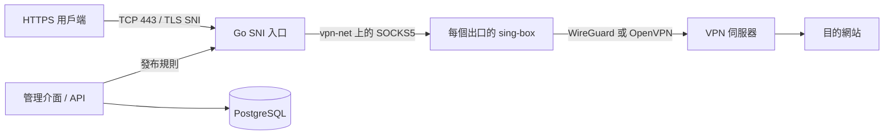

# SNI Gateway

[English](README.md)

依照網域名稱，將 HTTPS 連線送往不同的 VPN 出口。SNI Gateway 使用 Go 入口，**供應商與自訂 VPN 出口皆由 sing-box 處理**，並提供網頁介面管理出口、路由規則、訂閱及發布。

閘道讀取 TLS 的伺服器名稱指示（SNI），依已發布的規則選擇出口，再透過 VPN 轉送原始連線。TLS 連線維持在用戶端與目的網站之間，閘道不需要網站憑證或私鑰。

## 架構



Docker Compose 執行後端與 PostgreSQL。後端提供建置完成的 React 介面，為每個出口管理一個 `singbox-<出口名稱>` 容器，並在發布時切換至準備完成的路由表。

| 連接埠 | 用途 |
| --- | --- |
| 主機 TCP 80 | 將符合規則的網域轉至 HTTPS；未符合規則時回傳 404 |
| 主機 TCP 443 | 依已發布的 SNI 規則轉送 TLS；未符合規則時關閉連線 |
| `127.0.0.1:8080` | 管理介面與 API |
| 容器 TCP 1080 | 各出口在私有 `vpn-net` 網路上的 SOCKS 入口，不對主機公開 |

目的網站的 DNS 查詢經由選定的 VPN。若自訂 OpenVPN 設定以網域名稱指定 VPN 伺服器，建立通道前會先使用本機 DNS 解析該伺服器。

## 需求

- Docker 與支援 `up --wait` 的 Docker Compose v2，以及能存取 Docker daemon 的帳號。
- 安裝需要 Bash 與 OpenSSL；更新需要 Git 與 `flock`。
- 主機 TCP 80、443 及本機回環位址的 8080 連接埠可用。
- VPN 認證資料，或完整的自訂 WireGuard／OpenVPN 設定。

Docker 會建置後端與前端。只有在主機進行本機開發時，才需要另行安裝 Go 與 Node.js。

## 安裝

在專案目錄執行：

```bash
./sni-gateway.sh install
```

若尚無 `.env`，安裝程式會建立權限受限的檔案並產生隨機管理員認證資料，接著建置程式、準備後端指定的 sing-box 映像，並等待 Compose 健康檢查通過。已有的 `.env` 會保留，程式會驗證其中的認證設定。

開啟 `http://127.0.0.1:8080`，使用 `.env` 中的 `ADMIN_USERNAME` 與 `ADMIN_PASSWORD` 登入。遠端主機可使用 SSH 轉送管理連接埠：

```bash
ssh -L 8080:127.0.0.1:8080 user@gateway-host
```

接著開啟相同的本機網址。`.env` 與資料庫備份含有認證資料和 VPN 設定，請妥善保管。

## 設定路由

1. **建立出口。** 選擇內建供應商、國家或城市，以及 WireGuard 或 OpenVPN，再填入畫面要求的認證資料。使用自己的 VPN 伺服器時，選擇 **Custom configuration**，匯入 WireGuard `.conf`，或包含必要憑證與金鑰的可攜式 OpenVPN `.ovpn` 設定。
2. **確認出口。** 啟動時會透過 VPN 探測公網 IP。**Running** 表示探測成功；**Unhealthy** 表示失敗。**Logs** 可查看執行日誌，**Check status** 會重新探測目前連線。
3. **新增規則。** 將精確網域或網域尾碼對應至出口。規則頁支援搜尋與分頁。
4. **發布。** 在**發布**頁驗證並發布已儲存的規則。新連線會立即使用已發布的路由表；回復功能可還原上一版。訂閱同步也能發布更新。
5. **將用戶端流量送往閘道。** 設定用戶端 DNS 或 hosts，讓指定網域指向閘道，再以 HTTPS 存取。

認證資料依供應商與協定而異：OpenVPN 可能需要服務專用帳密及用戶端憑證；WireGuard 需要私鑰，部分供應商還需要通道位址與預共享金鑰。介面會顯示必要欄位。

供應商自動選擇模式會依已選城市篩選端點；未選城市時則使用國家。每次連線最多實測四個候選端點，測量從建立容器到成功取得公網 IP 的耗時，選擇最快成功的端點；正式連線失敗時，會嘗試其他已測試成功的候選。每次試連的公網 IP 探測最多 40 秒，整次連線流程上限為五分鐘；比較範圍僅限抽測的候選端點。**Restart** 會重新選擇；**Check status** 只探測目前端點。畫面中的公網 IP 是實測出口位址，可能與目錄中的 VPN 端點 IP 不同。

WireGuard 環境變數 YAML 與 OpenVPN YAML 是本程式的匯入／匯出格式，並非可獨立使用的 Compose 檔案。請參閱 [API 文件](docs/API.md)中的請求範例。

## 設定

在安裝或套用更新前編輯 `.env`：

| 變數 | 預設值／行為 |
| --- | --- |
| `ADMIN_USERNAME` | 首次安裝為 `admin` |
| `ADMIN_PASSWORD` | 首次安裝隨機產生 |
| `JWT_SECRET` | 首次安裝隨機產生 |
| `TLS_IDLE_TIMEOUT` | `5m`；雙向都沒有流量達此時間後關閉 TLS 連線 |
| `EXIT_RESTART_CRON` | `@every 12h`；設為 `disabled` 可停用定期重啟出口 |
| `PROVIDER_CATALOG_UPDATE_INTERVAL` | `24h` |

已發布的路由快照與供應商目錄快取儲存在 `published_routes` volume，PostgreSQL 使用 `postgres_data`。後端透過 Docker socket 建立、檢查及停止出口容器。

## 維運

```bash
# 檢查更新，不變更部署
./sni-gateway.sh update --check

# 備份 PostgreSQL、更新追蹤分支、重建並等待健康檢查
./sni-gateway.sh update --apply

# 檢查程式與 VPN 出口；將 EXIT_NAME 換成出口名稱
docker compose ps
docker compose logs --tail=100 backend
docker logs --tail=100 singbox-EXIT_NAME

# 停止受管理的出口與 Compose 服務
./scripts/stop.sh
```

更新程式會保留資料庫及路由 volume。現有 VPN 容器會繼續使用原本映像，直到重新啟動；更新映像後，請在介面使用 **Restart**。自動更新、備份與復原方式見[更新文件](docs/UPDATES.md)。

Compose 健康檢查確認程式是否就緒，並不驗證 VPN 能否連至目的網站。若要測試完整路徑，先建立並發布 `api.ipify.org` 的精確規則，再將下列 `GATEWAY_IP` 換成閘道 IP 後執行：

```bash
curl --noproxy '*' --max-time 30 \
  --resolve api.ipify.org:443:GATEWAY_IP https://api.ipify.org/
```

回應應為所選 VPN 的公網 IP。`--resolve` 將連線送到閘道，同時保留目的網域名稱與 TLS 憑證驗證。

若 Docker socket 回報權限不足，請檢查 `docker info` 與目前登入工作階段的群組。管理員授予 Docker 存取權後，需重新登入讓群組變更生效。若程式健康但 HTTPS 失敗，請查看出口日誌並執行 **Check status**；即使容器正在執行，DNS 或通道逾時仍可能造成轉送失敗。

## 開發驗證

```bash
(cd backend && go test -race ./... && go vet ./...)
python3 -m unittest discover -s scripts/tests -v
bash -n sni-gateway.sh
(cd frontend && npm ci && npm run build)

# 透過 Docker 建置完整程式
docker compose build
```

單元測試與映像建置不會建立真實 VPN 通道。完整驗證還需要可用的 VPN 出口，以及上述經由規則轉送的 HTTPS 請求。

## 支援範圍

支援帶有 SNI 的 TCP HTTPS，不轉送 QUIC／HTTP3 或沒有 SNI 的 TLS 連線。一般 HTTP 僅對符合規則的網域重新導向 HTTPS。閒置 TLS 連線依 `TLS_IDLE_TIMEOUT` 關閉，閘道停止時也會關閉現有 TLS 連線。

## 供應商資料與授權

供應商選單使用內建的 [Gluetun 伺服器資料](https://github.com/qdm12/gluetun-servers)快照，並在啟動時及設定的週期檢查目錄更新。OpenVPN 公開 CA 與 TLS 範本取自 Gluetun 供應商定義。VPN 流量由 sing-box 處理。

可從本機上游專案更新內建資料：

```bash
python3 scripts/update_provider_catalog.py /path/to/gluetun-servers
python3 scripts/update_openvpn_templates.py /path/to/gluetun
```

授權文件：[伺服器目錄](backend/internal/catalog/data/LICENSE.gluetun-servers)、[供應商範本](backend/internal/provider/data/LICENSE.gluetun)。舊版[發行說明](docs/releases/v1.1.md)描述的是該版本的架構。
